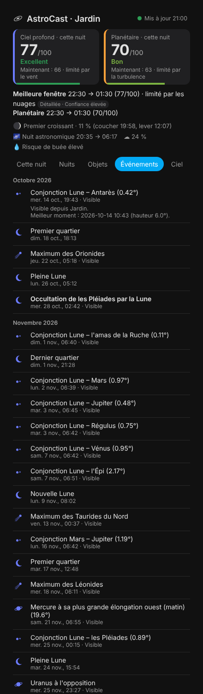
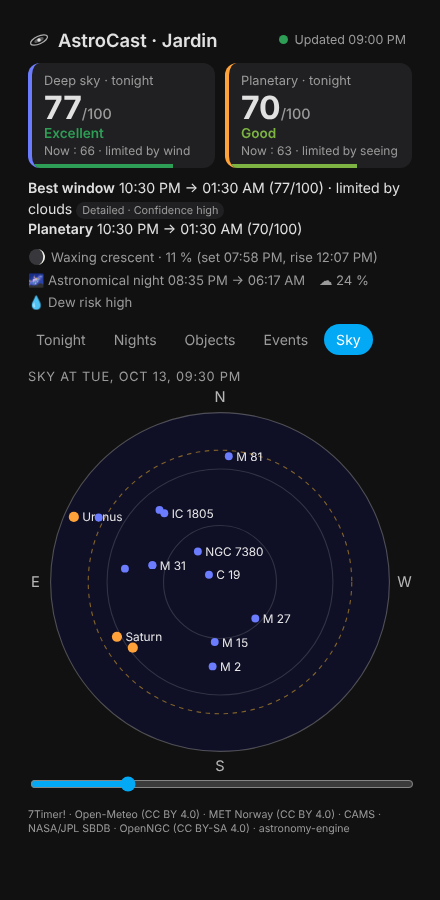
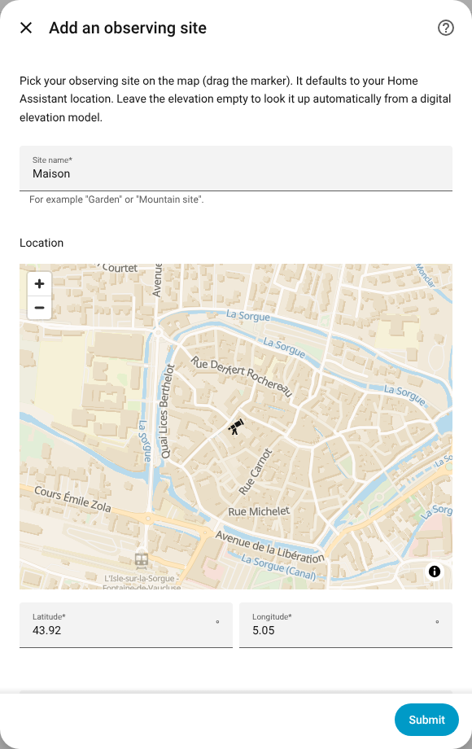

<p align="center">
  
</p>

<h1 align="center">AstroCast</h1>

<p align="center">
  <b>Prévisions d'astronomie et d'astrophotographie pour Home Assistant</b><br>
  Conditions d'observation · meilleures fenêtres · quoi observer ce soir · événements astronomiques
</p>

<p align="center"><a href="README.md">🇬🇧 English version</a></p>

AstroCast répond aux trois questions que se pose tout astronome amateur :

1. **Le ciel sera-t-il bon ce soir ?** — un score explicable de 0 à 100 pour le *ciel profond*
   et pour l'observation *planétaire*, la meilleure fenêtre de la nuit et ce qui la limite
   (nuages, Lune, crépuscule, transparence, turbulence, vent, humidité).
2. **Quel est le meilleur moment pour un objet donné ?** — hauteur, clair de Lune à la position
   de l'objet, météo et obscurité sont croisés nuit après nuit, pour toute planète, objet
   Messier/NGC/IC, comète ou astéroïde brillant.
3. **Quelles seront les meilleures nuits des prochains jours ?** — prévision détaillée jusqu'à
   72 h, prévision jusqu'à 7 jours, tendance *probabiliste* jusqu'à 15 jours, puis potentiel
   astronomique (heures sans Lune) au-delà.

Tout se configure depuis l'interface (avec une carte), plusieurs sites d'observation sont
possibles, et l'intégration fournit des entités, calendriers et actions utilisables dans les
automatisations — ainsi qu'un tableau de bord dédié.

| Cette nuit | Événements | Ciel |
| --- | --- | --- |
|  |  |  |

> **Statut : bêta (0.x).** Les fonctionnalités principales sont implémentées et testées ; les
> courbes de score continueront d'être ajustées grâce aux retours d'expérience.

## Fonctionnalités

- **Calculs astronomiques locaux et précis** — Soleil, Lune et planètes avec
  [astronomy-engine](https://github.com/cosinekitty/astronomy) (±1 minute d'arc par rapport au
  JPL), crépuscules, lever/coucher/passage au méridien, phase et illumination de la Lune,
  brillance du ciel due à la Lune (modèle de Krisciunas & Schaefer 1991). Comètes et astéroïdes
  calculés à partir des orbites du JPL (validés avec JPL Horizons).
- **Prévisions spécialisées et générales clairement distinguées**
  - *7Timer! ASTRO* (le modèle utilisé par Xasteria) : seeing, transparence, instabilité — 72 h ;
  - *Open-Meteo* : meilleurs modèles locaux (AROME/ARPEGE de Météo-France, ICON, ECMWF, GFS) — 16 jours ;
  - *Ensemble ECMWF* (51 membres) : probabilité de ciel dégagé et niveau de confiance — 15 jours ;
  - *Aérosols CAMS* : poussières et fumées pour estimer objectivement la transparence — 5 jours ;
  - *MET Norway* : secours automatique si Open-Meteo est indisponible.
- **Scores explicables** — chaque score est le produit de facteurs physiques ; le plus faible
  est indiqué comme facteur limitant. Chaque valeur indique sa source, son horizon
  (`détaillée` / `prévision` / `tendance`) et un niveau de confiance. Les estimations ne sont
  jamais présentées comme des mesures. → [Méthodologie](docs/methodology.md) (en anglais)
- **Quoi observer** — 635 objets du ciel profond (tous les Messier et Caldwell, NGC/IC
  brillants, nébuleuses nommées, noms français) issus d'OpenNGC, les planètes, la Lune, les
  comètes proches du périhélie et les astéroïdes brillants. Un objet n'est *recommandé* que s'il
  est assez haut, pendant la nuit noire, assez lumineux pour votre instrument et pas noyé par la
  Lune — avec les raisons affichées.
- **Favoris** — suivez n'importe quel objet ; un capteur indique sa prochaine fenêtre favorable.
- **Événements** — phases et super Lunes, éclipses de Lune et de Soleil (circonstances locales),
  oppositions, plus grandes élongations, conjonctions, occultations par la Lune, pluies de
  météores avec le taux horaire attendu sous votre ciel, équinoxes et solstices, comètes
  brillantes.
- **Intégration native** — configuration graphique avec carte, reconfiguration, options,
  plusieurs sites, entités traduites (français/anglais), calendriers pour les notifications,
  actions avec réponse, diagnostics, carte Lovelace et panneau latéral installés automatiquement
  (aucune ressource à ajouter, aucun YAML).
- **Robuste et léger** — chaque source a son propre rythme de mise à jour, avec temporisation
  en cas d'erreur, cache persistant et dégradation progressive (les calculs astronomiques
  fonctionnent même sans réseau).

## Installation

### Avec HACS (recommandé)

1. Dans HACS, menu ⋮ → **Dépôts personnalisés**, ajoutez
   `https://github.com/FigurinePanda43/AstroCast` avec la catégorie **Intégration**.
2. Recherchez **AstroCast**, installez-le puis **redémarrez Home Assistant**.
3. **Paramètres → Appareils et services → Ajouter une intégration → AstroCast**.

### Manuelle

Copiez `custom_components/astrocast` dans le dossier `custom_components` de votre configuration,
redémarrez puis ajoutez l'intégration depuis l'interface.

**Prérequis :** Home Assistant 2025.1 ou plus récent. Les dépendances (`astronomy-engine`, en
Python pur, et `numpy`, déjà fourni avec Home Assistant) s'installent automatiquement.

## Configuration

1. **Site** — donnez-lui un nom et déplacez le marqueur sur la carte (par défaut, votre
   domicile). Laissez l'altitude vide pour l'obtenir depuis le modèle numérique de terrain
   Copernicus.

   
2. **Votre pratique** — qualité du ciel (échelle de Bortle), instrument principal, hauteur
   minimale utilisable (arbres, bâtiments…) et score à partir duquel les conditions sont jugées
   *bonnes*.

Ajoutez à nouveau l'intégration pour chaque site supplémentaire. **Reconfigurer** permet de
déplacer ou renommer un site, **Configurer** (options) de changer les préférences, saisir une
mesure SQM, décrire votre horizon local (obstacles sous forme de couples `azimut:hauteur`, par
ex. `0:15, 90:30, 180:10, 270:25`), choisir des objets favoris ou masquer le panneau latéral.

## Tableau de bord

Une entrée **AstroCast** apparaît dans la barre latérale (désactivable dans les options). La
même vue existe sous forme de carte dans le sélecteur de cartes :

```yaml
type: custom:astrocast-card
# entry_id: 0123456789abcdef   # facultatif : un site précis (par défaut le premier)
# default_tab: nights          # tonight | nights | objects | events | sky
# view: compact                # en-tête seul (scores, meilleure fenêtre, Lune, crépuscules)
```

Onglets : **Cette nuit** (frise avec crépuscules, scores, nuages, Lune et meilleure fenêtre ;
touchez la frise pour inspecter un instant), **Nuits** (prévisions avec horizon et confiance,
puis potentiel astronomique), **Objets** (recommandations argumentées, recherche, favoris),
**Événements**, **Ciel** (carte du ciel des planètes et meilleures cibles à tout moment de la
nuit).

## Entités principales

Pour chaque site : scores *Ciel profond ce soir*, *Planétaire ce soir*, *maintenant*, *Meilleure
nuit à venir*, *Couverture nuageuse*, *Seeing* et *Transparence* (désactivés par défaut), *Phase*
et *Illumination de la Lune*, *Crépuscule* et *Aube astronomiques*, *Prochain événement*,
*Meilleure cible ce soir*, *Planètes visibles*, un capteur par favori, l'état des *Sources de
données* ; les capteurs binaires *Nuit astronomique* (qui bascule à l'instant exact) et *Bonnes
conditions d'observation* ; les calendriers *Fenêtres d'observation* et *Événements
astronomiques*. La liste détaillée figure dans le [README anglais](README.md#entities).

## Automatisations

Les calendriers permettent d'être prévenu *avant* une bonne nuit :

```yaml
automation:
  - alias: "Télescope : bonne fenêtre dans 2 heures"
    triggers:
      - trigger: calendar
        event: start
        offset: "-2:00:00"
        entity_id: calendar.jardin_fenetres_d_observation
    actions:
      - action: notify.mobile_app_telephone
        data:
          title: "🔭 {{ trigger.calendar_event.summary }}"
          message: "{{ trigger.calendar_event.description }}"
```

(L'identifiant exact de l'entité dépend du nom du site et de la langue : vérifiez-le dans
**Paramètres → Entités**.) D'autres exemples sont dans [docs/automations.md](docs/automations.md).

## Actions

- `astrocast.get_forecast` — nuits à venir (scores, fenêtres, météo, objets, événements) ;
- `astrocast.get_object_visibility` — meilleurs moments pour un objet (`Jupiter`, `M31`,
  `NGC 7000`, `Nébuleuse d'Orion`…) sur 16 nuits ;
- `astrocast.add_favorite` / `astrocast.remove_favorite` — gestion des favoris.

## Sources de données et fiabilité

Tous les services sont gratuits et sans clé : 7Timer!, Open-Meteo (CC BY 4.0, usage non
commercial), MET Norway (CC BY 4.0), CAMS (Copernicus), NASA/JPL SBDB ; catalogue OpenNGC
(CC BY-SA 4.0) intégré. Environ 40 requêtes par site et par jour.
Détails, licences et conditions d'utilisation : [docs/data-sources.md](docs/data-sources.md).

**Confidentialité :** seules les coordonnées du site (arrondies à ~10 m) sont transmises aux
services météo ci-dessus. Les diagnostics les arrondissent à ~10 km.

## Limites connues

- Les prévisions sont des sorties de modèles, pas des mesures. Au-delà de 72 h, le seeing est
  une estimation grossière fondée sur le courant-jet, et la magnitude des comètes est très
  incertaine : les deux sont signalés comme estimations.
- La pollution lumineuse provient de votre réglage Bortle (ou SQM) ; pas de carte automatique.
- Le catalogue se concentre sur les ~600 objets du ciel profond les plus intéressants ; les
  étoiles doubles et variables ne sont pas encore couvertes.
- Le profil d'horizon est une simple ligne brisée de points `azimut:hauteur` (pas encore
  d'import de panorama ou de fichier d'horizon).

## Licences et remerciements

Code sous licence MIT. Catalogue dérivé d'[OpenNGC](https://github.com/mattiaverga/OpenNGC)
© Mattia Verga, sous [CC BY-SA 4.0](custom_components/astrocast/data/LICENSE-catalog.md).
[astronomy-engine](https://github.com/cosinekitty/astronomy) © Don Cross (MIT). Données météo :
7Timer!, Open-Meteo, MET Norway, Copernicus CAMS ; orbites : NASA/JPL.
