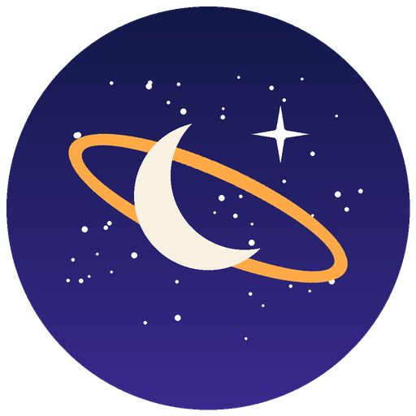
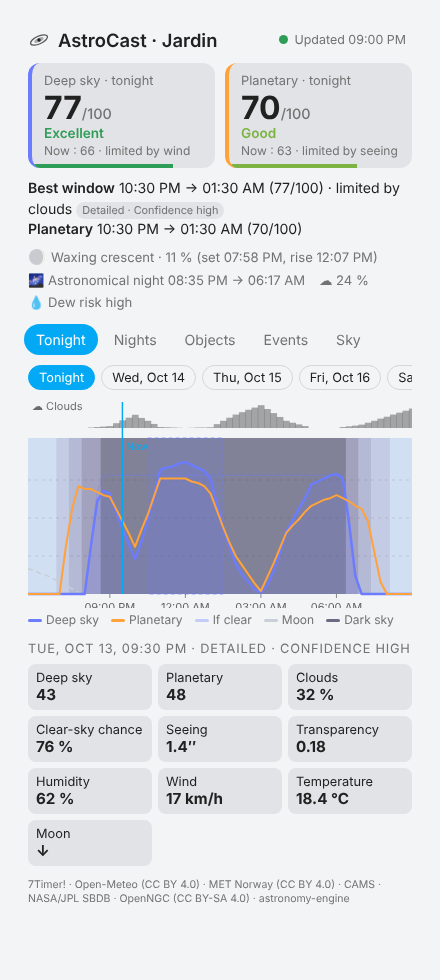
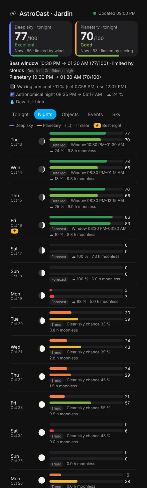
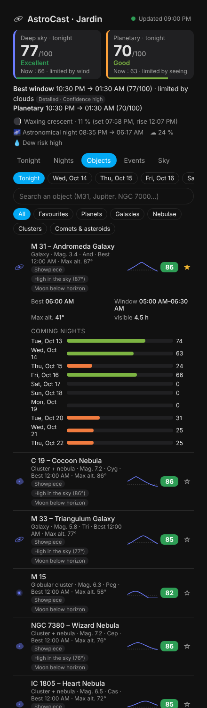
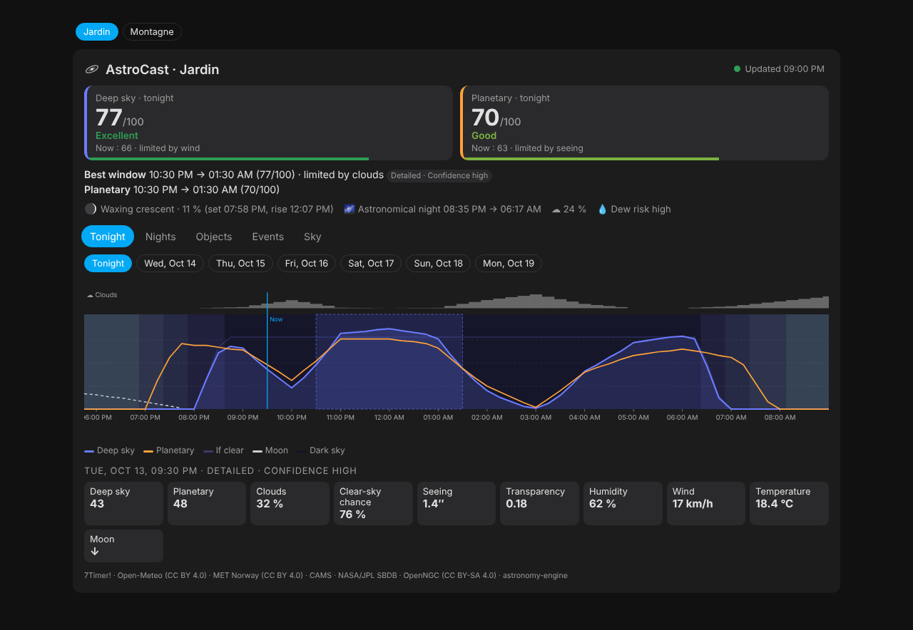

<p align="center">
  
</p>

<h1 align="center">AstroCast</h1>

<p align="center">
  <b>Astronomy &amp; astrophotography forecasts for Home Assistant</b><br>
  Observing conditions · best windows · what to observe tonight · astronomical events
</p>

<p align="center">
  <a href="https://hacs.xyz"></a>
  <a href="https://github.com/FigurinePanda43/AstroCast/actions/workflows/tests.yml"></a>
  <a href="https://github.com/FigurinePanda43/AstroCast/actions/workflows/validate.yml"></a>
  
  
</p>

<p align="center"><a href="README.fr.md">🇫🇷 Lire en français</a></p>

AstroCast answers the three questions every amateur astronomer asks:

1. **Will the sky be good tonight?** — an explainable 0–100 score for *deep-sky* and for
   *planetary* observing, the best window of the night and what limits it (clouds, Moon,
   twilight, transparency, seeing, wind, humidity).
2. **When is the best moment for a given object?** — altitude, moonlight at the object,
   weather and darkness are combined night after night, for any planet, Messier/NGC/IC object,
   comet or bright asteroid.
3. **Which are the best nights in the coming days?** — detailed forecast up to 72 h,
   forecast up to 7 days and *probabilistic* trend up to 15 days, then the dark-sky
   potential (Moon-free hours) beyond.

Everything is configured from the UI (with a map), works with several observing sites, and
exposes useful entities, calendars and actions for automations — plus a dedicated dashboard.

| Tonight | Nights | Objects |
| --- | --- | --- |
|  |  |  |



> **Status: beta (0.x).** The core features are implemented and tested, but the scoring
> curves will keep being tuned with real-world feedback. Please report your experience!

## Features

- **Local, accurate astronomy** — Sun, Moon and planets from
  [astronomy-engine](https://github.com/cosinekitty/astronomy) (±1 arcminute vs JPL),
  twilights, rise/set/transit, lunar phase and illumination, moonlight sky brightness
  ([Krisciunas & Schaefer 1991](https://doi.org/10.1086/132921)). Comets and asteroids are
  propagated from JPL orbital elements (validated against JPL Horizons).
- **Specialised and general forecasts, clearly separated**
  - *7Timer! ASTRO* (the model behind Xasteria): seeing, transparency, instability — 72 h.
  - *Open-Meteo*: best local models (e.g. Météo-France AROME/ARPEGE, ICON, ECMWF, GFS) — 16 days.
  - *ECMWF ensemble* (51 members): probability of clear sky and forecast confidence — 15 days.
  - *CAMS aerosols*: dust and smoke for an objective transparency estimate — 5 days.
  - *MET Norway*: automatic fallback when Open-Meteo is unavailable.
- **Explainable scores** — each score is a product of physical factors; the weakest one is
  reported as the limiting factor. Every value carries its source, forecast tier
  (`detailed` / `forecast` / `trend`) and a confidence level. Estimates are never shown as
  measurements. → [Methodology](docs/methodology.md)
- **What to observe** — 635 deep-sky objects (all Messier and Caldwell objects, bright NGC/IC,
  named nebulae) from OpenNGC, the planets, the Moon, comets near perihelion and bright
  asteroids. Objects are *recommended* only when they are high enough, during darkness, bright
  enough for your equipment and not drowned by moonlight — with the reasons why.
- **Favourites** — follow any object; a sensor gives its next favourable window.
- **Events** — lunar phases and supermoons, lunar and local solar eclipses, oppositions,
  greatest elongations, planetary and lunar conjunctions, lunar occultations, meteor showers
  with the expected hourly rate under your sky, equinoxes and solstices, bright comets.
- **Home Assistant native** — UI config flow with a map, reconfigure and options flows,
  multiple sites, translated (English/French) entities, calendars for notifications,
  actions with responses, diagnostics, a Lovelace card and a sidebar panel that install
  themselves (no resource to add, no YAML).
- **Robust and light** — each provider is refreshed on its own schedule, with back-off,
  persistent cache and graceful degradation (astronomy keeps working with no network at
  all). Heavy computations run in an executor and take ~0.5 s per update on a desktop x86 CPU
  (expected to be a few seconds on a Raspberry Pi 4).

## Installation

### HACS (recommended)

1. In HACS, open the menu ⋮ → **Custom repositories**, add
   `https://github.com/FigurinePanda43/AstroCast` with the category **Integration**.
2. Search for **AstroCast**, install it and **restart Home Assistant**.
3. Go to **Settings → Devices & services → Add integration → AstroCast**.

### Manual

Copy `custom_components/astrocast` into the `custom_components` folder of your Home Assistant
configuration, restart, then add the integration from the UI.

**Requirements:** Home Assistant 2025.1 or newer. Dependencies (`astronomy-engine`, pure
Python, and `numpy`, already shipped with Home Assistant) are installed automatically.

## Configuration

1. **Site** — name it and drag the marker on the map (defaults to your home). Leave the
   elevation empty to get it from the Copernicus digital elevation model.
2. **How you observe** — sky darkness (Bortle scale), main equipment, lowest usable altitude
   (trees, buildings…) and the score above which conditions are considered *good*.

Add the integration again for each additional site. Use **Reconfigure** to move or rename a
site and **Configure** (options) to change preferences, set a measured SQM value, pick
favourite objects, or hide the sidebar panel.

## Dashboard

An **AstroCast** entry appears in the sidebar (can be disabled in the options). The same view
is available as a card in the card picker:

```yaml
type: custom:astrocast-card
# entry_id: 0123456789abcdef   # optional: a specific site (default: the first one)
# default_tab: nights          # tonight | nights | objects | events | sky
# view: compact                # header only (scores, best window, Moon, twilight)
```

Tabs: **Tonight** (timeline with twilight, scores, clouds, Moon, best window; tap to inspect
any time), **Nights** (outlook with tier and confidence, then dark-sky potential),
**Objects** (recommendations with reasons, search, favourites), **Events**, **Sky**
(all-sky chart of the planets and best targets for any time tonight).

## Entities

Per site (`<site>` is the site name):

| Entity | Description |
| --- | --- |
| `sensor.<site>_deep_sky_tonight` | Deep-sky score of the night (0–100) — attributes: rating, best window, limiting factor, confidence, Moon, twilight… |
| `sensor.<site>_planetary_tonight` | Same for planetary/lunar observing |
| `sensor.<site>_deep_sky_now` / `_planetary_now` | Current scores with every factor |
| `sensor.<site>_best_upcoming_night` | Start of the best upcoming window; attributes list every night |
| `sensor.<site>_cloud_cover` | Current cloud cover (with clear-sky probability) |
| `sensor.<site>_seeing` · `_transparency_extinction` | Seeing (″) and V-band extinction (mag/airmass) — *disabled by default* |
| `sensor.<site>_moon_phase` · `_moon_illumination` | Lunar phase and illuminated fraction |
| `sensor.<site>_next_moonrise` · `_next_moonset` | *disabled by default* |
| `sensor.<site>_astronomical_dusk` · `_astronomical_dawn` | Tonight's astronomical night |
| `sensor.<site>_next_astronomical_event` | Next notable event (title, visibility, list) |
| `sensor.<site>_best_target_tonight` | Best object tonight (top 10 in attributes) |
| `sensor.<site>_planets_visible_tonight` | Number of planets worth observing |
| `sensor.<site>_<object>_next_window` | One per favourite: next favourable window |
| `sensor.<site>_data_sources` | Health of every data source (diagnostic) |
| `binary_sensor.<site>_astronomical_night` | On while the Sun is below −18°, switching at the exact instant |
| `binary_sensor.<site>_good_observing_conditions` | On when a score reaches your threshold |
| `calendar.<site>_observing_windows` | Every forecast window above your threshold |
| `calendar.<site>_astronomical_events` | Eclipses, showers, conjunctions, phases… |

Large lists are kept out of the recorder to protect your database.

## Automations

Calendars are the easiest way to be warned *before* a good night:

```yaml
automation:
  - alias: "Telescope: good window in 2 hours"
    triggers:
      - trigger: calendar
        event: start
        offset: "-2:00:00"
        entity_id: calendar.garden_observing_windows
    actions:
      - action: notify.mobile_app_phone
        data:
          title: "🔭 {{ trigger.calendar_event.summary }}"
          message: "{{ trigger.calendar_event.description }}"
```

More examples (evening summary, switching garden lights off during astronomical night,
meteor shower reminder, favourite object alert, using the actions in scripts) are in
[docs/automations.md](docs/automations.md).

## Actions

| Action | Description |
| --- | --- |
| `astrocast.get_forecast` | Nights with both scores, windows, weather summary, top objects and events (response) |
| `astrocast.get_object_visibility` | Best moments for any object (`Jupiter`, `M31`, `NGC 7000`, `Orion Nebula`…) over 16 nights (response) |
| `astrocast.add_favorite` / `astrocast.remove_favorite` | Manage favourites |

## Data sources and reliability

| Source | Used for | Range | Refresh |
| --- | --- | --- | --- |
| [7Timer! ASTRO](https://www.7timer.info) | Seeing, transparency, instability | 72 h | 3 h |
| [Open-Meteo](https://open-meteo.com) forecast | Clouds by layer, humidity, dew point, wind, gusts, precipitation, jet stream | 16 days | 1 h |
| [Open-Meteo](https://open-meteo.com) ensemble (ECMWF IFS) | Clear-sky probability, confidence | 15 days | 6 h |
| [Open-Meteo](https://open-meteo.com) air quality (CAMS) | Aerosol optical depth → transparency | 5 days | 6 h |
| [MET Norway](https://api.met.no) | Fallback weather | ~10 days | 1 h, only if needed |
| [NASA/JPL SBDB](https://ssd-api.jpl.nasa.gov) | Comet and asteroid orbits | — | daily |
| [OpenNGC](https://github.com/mattiaverga/OpenNGC) | Deep-sky catalog (bundled) | — | — |

All services are free and keyless. About 40 requests per site per day are made, well within
fair-use limits. Details, licences and terms: [docs/data-sources.md](docs/data-sources.md).

**Privacy:** the site coordinates (rounded to 3–4 decimals, ~10 m) are sent to the weather
services above, nothing else. Diagnostics round them to ~10 km.

## Limitations

- Forecasts are model outputs, not measurements. Seeing beyond 72 h is a coarse jet-stream
  proxy, and comet magnitudes are notoriously uncertain — both are labelled as estimates.
- Light pollution is taken from your Bortle setting (or SQM); there is no automatic
  light-pollution map.
- The catalog focuses on the ~600 most rewarding deep-sky objects; double stars and
  variable stars are not covered yet.
- Local horizon masks (azimuth-dependent obstacles) are not supported yet; only a minimum
  altitude.

## Development

```bash
python3.14 -m venv venv && . venv/bin/activate
pip install -r requirements_test.txt
pytest                      # 80+ tests (engine and Home Assistant)
ruff check . && ruff format --check .
```

The computation engine (`custom_components/astrocast/engine`) does not depend on Home
Assistant. The deep-sky catalog is regenerated with `scripts/build_catalog.py`.

## Credits and licences

- Code: MIT © AstroCast contributors.
- Deep-sky catalog derived from [OpenNGC](https://github.com/mattiaverga/OpenNGC) © Mattia
  Verga, [CC BY-SA 4.0](custom_components/astrocast/data/LICENSE-catalog.md).
- [astronomy-engine](https://github.com/cosinekitty/astronomy) © Don Cross (MIT).
- Weather data: 7Timer!, Open-Meteo (CC BY 4.0), MET Norway (CC BY 4.0), Copernicus
  Atmosphere Monitoring Service; orbits: NASA/JPL.
